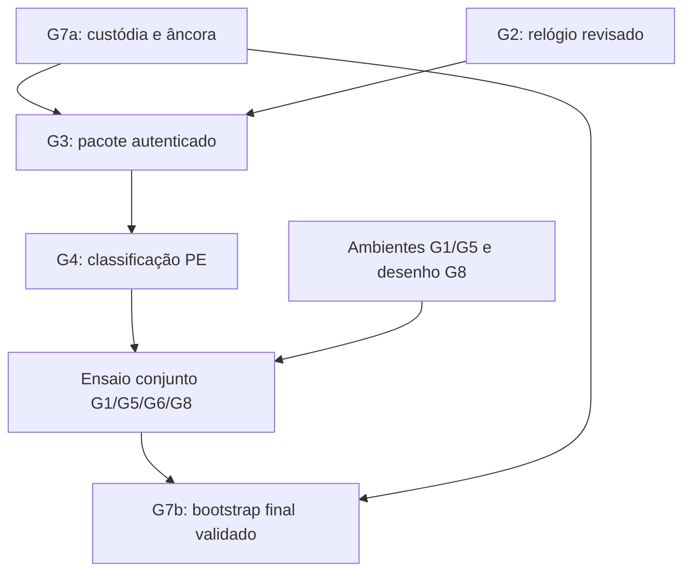

# Autoatualizador GF — Etapa 6: preparação do desbloqueio técnico

28/10/2026, America/Fortaleza. **Preparação concluída; oito gates operacionais
continuam bloqueados, zero fechado nesta etapa. Etapa 7 NÃO INICIADA.**
PR #65 aberta/Draft, work-integracao-final-20261027. Entrada
`5f265c7606164120406bf44a5d5bf6b29774cef4`, árvore
`8591f7b09b9775e2fe7733de0e2aacc2b4901bf4`.
Checkpoint, contrato gf-self-update/1 e matriz G1–G8 da Etapa 5 conferidos.
Leitura complementar restrita ao patch/clock de fixture, deadline e plano de
custódia necessários às dependências. Sem reabertura da revisão do produto.

Entrega: dependências, alternativas, critérios mínimos de evidência, bloqueios
externos e decisões pendentes. Apenas Markdown/JSON; **zero código, build,
ensaio de segurança, teste físico, CI, chave ou infraestrutura novos**.
As verificações locais de JSON, referências, grafo e preservação documental
não são testes operacionais nem pontos do roadmap.

## Preparação resolvida com os recursos disponíveis

1. Separada **G7a — custódia/âncora pública** de **G7b — bootstrap final**.
   G7a fornece confiança para G3; G7b só é aceito depois do pacote e do ensaio
   conjunto. Essa separação elimina uma espera circular no planejamento; não
   cria raiz, assina pacote ou fecha G7.
2. Confirmado no contrato: **beta-unsigned é o perfil inicial permitido**.
   Certificado/publicador obrigatório não se torna pré-requisito novo por
   inferência. A classificação do PE GF real continua pendente em G4.
3. Delimitado G1 em **armazenamento** e **frescor após restauração integral**.
   Um corte de energia não demonstra antirreplay de snapshot completo; um
   recibo antigo íntegro não demonstra frescor. Nenhuma das garantias é relaxada.
4. Especificados critérios de adoção para G2 e G8 por inspeção estática: a API
   experimental aceita TimeProvider genérico, enquanto a fixture usa uma classe
   sealed que devolve um valor capturado. A API, sozinha, não impõe imutabilidade.
   ObserveRead recebe Task já criada e limita a espera; o futuro desenho deve
   controlar início e término das operações, além de conferir cancelamento.
   Não se afirma defeito no produto, nem nova prova de execução desses casos.
5. Confirmada a inadequação do perfil padrão de runner para o positivo G5:
   a observação anterior Default=1/erro 1312 é compatível com a configuração
   administrativa documentada pelo GitHub. Uma nova run igual não substituiria
   um contexto padrão já preparado; não foi iniciada.

## Ordem de dependências, sem exigir publicação

O diagrama representa **insumos e ordem de ensaio**, não gates aprovados.
O ensaio conjunto produz evidências para G1/G6/G8; não exige que esses gates
já estejam integralmente fechados para poder observá-los. Sua aceitação e a
entrega final continuam condicionadas a todas as provas pertinentes.

G7a e ambientes podem ser preparados em paralelo em futuro escopo autorizado;
G2 pode ser revisado com chaves públicas de fixture. Isso não autoriza geração
de chaves operacionais, provisionamento ou início da Etapa 7. Não é preciso
alterar o canal privado para definir critérios, revisar código ou preparar o
dossiê público de custódia; a entrega futura permanece uma decisão separada.

## Decisão por gate

| Gate | Dependência e alternativa segura | Evidência mínima e estado atual |
| --- | --- | --- |
| G1 — armazenamento/frescor | Ambiente com disco persistente e controle externo de falha; decisão D6-01 sobre garantia após restauração integral. Alternativa de frescor independente pode ser manual autenticada, se desenhada/aprovada; não impor serviço/rede ao transporte offline. Ausência de frescor mantém bloqueio | E6-STORAGE + E6-FRESHNESS. Imagem, pilha/cache e evento real de corte/restauração registrados; observação externa não restaurada com o estado. Kill de processo, flush ou snapshot simulado não bastam. Recursos/protocolo de frescor não fornecidos |
| G2 — relógio TUF | D6-02: implementação suportada com horário fixo, ou fonte fixada com adaptação pequena, revisão e manutenção assumidas. Preflight externo com relógio interno livre não é alternativa equivalente | E6-CLOCK. SHA/diff/locks/licenças, responsável de manutenção, parecer e casos pertinentes de validade/rotação/cache/piso. Um único valor UTC capturado e prazo monotônico; TimeProvider mutável não é aceitação. Sem adoção operacional |
| G3 — pacote GF autenticado | G7a + G2 + candidato/receita autorizados por D6-05. Preparar em sandbox fora do produto; pacote de fixture não substitui GF e .66 não vira alvo gerenciado | E6-PACKAGE. Âncora pública previamente autenticada, cadeia TUF, vínculo origem/perfil/versão/ZIP/manifesto/PE/runtime/licenças/estado e limites reais. Sem pacote futuro autenticado fornecido; não gerar/reassinar .66 |
| G4 — PE/publicador | G3 e modo declarado nos metadados autenticados. Ramo atual beta-unsigned; ramo assinado obrigatório só mediante D6-06 futura. Windows trust/assinatura SDK não são autoria GF | E6-PE. Classificação real do PE GF, ausência/presença de tabela, resultado de confiança quando aplicável, sem downgrade de falha assinada. Publicador/revogação/timestamp apenas no ramo que os exige. Falta candidato GF, não impor certificado novo |
| G5 — IPC/contextos | D6-03: VM descartável com conta padrão e pares de sessão/usuário já autorizados. Linux/Wine, token elevado ou enumeração WTS não são substitutos. Não criar contas, alterar UAC/ACL ou usar PC FORTE nesta sessão | E6-CONTEXT. Tokens reais não elevados, SID/sessão comparados sem expor identidade pessoal, PID/imagem/parent/nonce e recusas entre fronteiras. Erro 1312 anterior não é handshake; contexto necessário não disponibilizado |
| G6 — ciclo GF | G3/G4 + contexto G5 + desenho de exclusividade/recuperação e prazo. Ensaio conjunto observa G1/G6/G8 com componentes qualificados, sem converter .66 ou integrar protótipo ao principal | E6-LIFECYCLE. Participantes GF reais, confirmação, instâncias/workers, saída/READY, pins/carga tardia/inserção, diário/seletor/recuperação e dados preservados. Os 274 pins da sonda não comprovam esses participantes |
| G7 — custódia/bootstrap | G7a primeiro: autorização específica e meios offline/quórum; G7b depois: bootstrap manual aprovado com hashes/protocolo/âncora. Não exige colaboradores GitHub nem credenciais novas por inferência | E6-CUSTODY + E6-BOOTSTRAP. Recibos públicos de cerimônia/backup/rotação/recuperação, fingerprint independente e bundle final validado. Slots continuam vazios; nenhuma privada gerada/solicitada para repositório ou job |
| G8 — prazo/I/O | D6-07: desenho que controla início/ownership/drenagem das operações e registra resultado desconhecido; compartilhar prazo nas fases pertinentes. Não liberar recursos/reiniciar outra tentativa enquanto I/O ainda pode produzir efeito | E6-DEADLINE. Linha temporal do pipeline real, tarefas/handles até término, ausência de commit tardio e falha de armazenamento. WaitAsync e read cooperativo de 120 s anteriores são subprovas; hardware/Flush/rename bloqueante e pipeline GF não demonstrados |

[Dossiê de evidências mínimas](WORK-AUTOATUALIZADOR-ETAPA6-EVIDENCIAS-MINIMAS.md) ·
[Dependências/alternativas/decisões em JSON](evidencias/autoatualizador-etapa6-dependencias.json) ·
[Recibo, fontes e verificações documentais](evidencias/autoatualizador-etapa6.json).

## Decisões pendentes e bloqueios externos

| ID | O que falta decidir/fornecer | Responsabilidade e limite |
| --- | --- | --- |
| D6-01 | Escopo de resistência a restauração integral e mecanismo de frescor, se exigido além da fronteira local | Mantenedor/revisão de segurança. Contrato exclui comprometimento do usuário/admin, mas não autoriza afirmar que o contraexemplo foi resolvido; não reduzir garantia unilateralmente |
| D6-02 | Rota de adoção do relógio, responsável de manutenção e revisão específica | Mantenedor/revisor. Não trocar biblioteca ou promover patch a produto nesta preparação |
| D6-03 | Host descartável com controle de falha/disco e contextos Windows padrão/sessões autorizadas | Responsável pelo laboratório. Não instalar hypervisor, criar conta, cadastrar runner ou ampliar permissões por inferência |
| D6-04 | Autorização específica da cerimônia e designação de custódia/meios para os slots existentes | Mantenedor/custódia. Esta missão não autoriza criar chaves operacionais; não pedir privadas, senha, PAT, cookie ou credencial nos recibos |
| D6-05 | Candidato GF isolado e participantes/protocolo qualificados que serão objeto dos ensaios | Mantenedor/desenvolvimento. Nenhuma versão atribuída, build/publicação ou integração ao principal nesta sessão |
| D6-06 | Só se futuramente desejar modo Authenticode obrigatório: publicador e política de revogação/timestamp | Condicional, não bloqueio artificial ao beta-unsigned atual; nenhuma decisão de mudar esse perfil tomada |
| D6-07 | Limites do prazo, ownership e estado de resultado desconhecido para I/O não drenado | Revisão de engenharia. Critério de aceitação preparado, sem prometer interromper qualquer driver ou resolver armazenamento travado por um token |

Não há impedimento do conector para salvar a preparação; os impedimentos são
os insumos, ambientes e aprovações técnicas acima. Não foram procurados segredos,
provisionadas contas/infraestrutura ou enviados pedidos a terceiros.

## Preservação e encerramento

BETA **v5.13.11.66**, fonte `6df95fdd776644cd4b248b5cea61108974ca9ce9`,
run privada 40716548530/tentativa 1/artefato 12828262039 e ZIP SHA-256
`8e11f2dda5b7e2df2f85c61b57cc6a31a9596628523d2be7ad155dfdd5dda7f2`
intactos; sem download, recompilação ou requalificação. Canal privado, retenção,
acessos, workflows, código e evidências anteriores preservados. **27/42**,
mesmos IDs/done e avaliação física parcial. Zero repetição física ou operacional.

AVG/proteções, consentimento/dados, VLC só inventário/zero consultas ou ações
específicas, WinGet COM opcional/consultivo e drivers instalar/remover/reverter
inativos preservados. Remoto bloqueado, PILOT_ENABLED=no/GITHUB_EXPORT_ENABLED=no;
sem Worker/D1/DNS, infraestrutura, ACL/token/UAC/privilégios, trust store,
chaves operacionais, bootstrap instalado, integração, merge/Release/publicação.
**Parar após salvar/conferir esta etapa; não iniciar a Etapa 7.**

Fontes primárias adicionais, consultadas apenas para as alternativas novas:
[GitHub — perfil de privilégios dos runners](https://docs.github.com/en/actions/reference/runners/github-hosted-runners#administrative-privileges)
e [Microsoft — semântica de desligamento de VM](https://learn.microsoft.com/en-us/powershell/module/hyper-v/stop-vm?view=windowsserver2025-ps).
Documentação de API e ordem de dependência não são evidência de ensaio executado.
