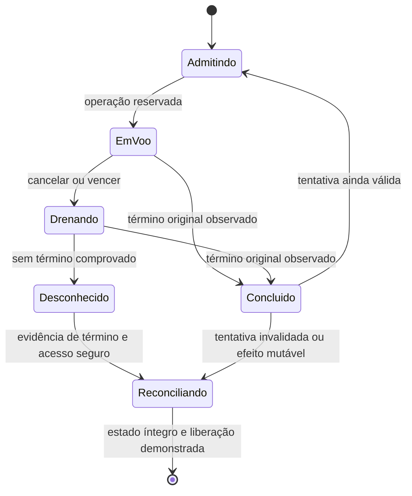

# Etapa 7 — desenho de prazo, ownership e I/O

**Decisão de arquitetura documental A7-04/A7-05. Sem implementação ou ensaio.
G8 e G1/G6 dependentes continuam bloqueados.** Nomes de estados abaixo são
conceituais: não estendem o wire format gf-self-update/1 nem substituem o diário
de fixture por um novo formato aceito em produto.

## Evidência disponível e limite das APIs

O [StageDeadline da Etapa 5](../prototipos/autoatualizador-seguro/stage5/src/Deadline.cs.txt)
compartilha Stopwatch/token e recebe Task já criada em ObserveRead. A
[evidência Windows anterior](evidencias/autoatualizador-etapa5-windows.json)
observou read cooperativo cancelado e read sem token concluindo depois do
cancelamento da espera. Não se repetiu nenhum deles, inclusive os 120 segundos.

As referências primárias consultadas nesta revisão delimitam o desenho:

- [Task.WaitAsync](https://learn.microsoft.com/en-us/dotnet/api/system.threading.tasks.task.waitasync?view=net-10.0)
  representa a espera, que pode terminar sem a tarefa original terminar.
- [CancelIoEx](https://learn.microsoft.com/en-us/windows/win32/api/ioapiset/nf-ioapiset-cancelioex)
  solicita cancelamento; o término pode ser sucesso, cancelamento ou outro erro,
  e deve ser observado antes de reutilizar os recursos da operação.
- [Cancelamento de I/O Windows](https://learn.microsoft.com/en-us/windows/win32/fileio/canceling-pending-i-o-operations)
  depende do suporte do driver; ReplaceFile consta entre as operações sem esse
  cancelamento. Timeout não torna troca de seletor ou Flush seguramente abortados.

São limites documentados de API, não provas de armazenamento ou de um helper GF.

## Escopo dos prazos, sem reiniciar o orçamento por fase

O orçamento de **120 s de validação/extração** do contrato começa antes do
primeiro I/O pertinente da tentativa: origem/container, TUF, portátil, ZIP,
hashes, PE/runtime/licenças/perfil e conferências de identidade. Filas internas
e repetição de leitura consomem o mesmo orçamento. Não atribuir dois minutos
novos a cada papel, arquivo, await ou nova chamada da facade.

Tempo de consentimento/espera humana não é validação. Um plano pode ser exibido,
mas seu ticket vencido não autoriza commit: pedir nova validação explícita e
confirmação do plano aplicável, sem mudar bytes/versão/perfil às escondidas.
Não reiniciar o prazo de trabalho já iniciado nem chamar isso de retomada segura.
Prontidão pós-abertura continua com o limite próprio de **30 s** do contrato;
recuperação não herda permissão de atualizar a partir de metadados vencidos.

Antes de persistir intenção e antes de iniciar publicação do seletor, o
coordenador confere prazo, geração de confiança, consentimento, contexto,
exclusividade, ausência de I/O pendente e identidades. Se a intenção já foi
persistida e um gate falha, entrar na recuperação definida, preservando pisos
e predecessor exato. Expirar metadados nunca desativa a aplicação já instalada.

Não se promete que uma syscall já iniciada termine antes de 120 s. O requisito
permanece limite de admissão/aceitação da validação e bloqueio de commit inválido,
com falha segura; sua implementação e comportamento sob armazenamento travado
precisam de prova. Não declarar cancelamento completo ou ausência de efeito
tardio enquanto houver uma operação de resultado desconhecido.
Não se aprovou transformar os dois minutos em simples prazo de resposta da UI.
Se a implementação não puder demonstrar aborto seguro/impedimento de commit
nas condições requeridas, G8 permanece bloqueado nesse ambiente; nenhuma
garantia de disponibilidade ou cancelamento foi reduzida por esta decisão.

## Proprietário único da tentativa e de cada operação

O futuro coordenador interno é dono do ciclo, token, lease de instalação,
handles/IDs, buffers, tarefa original, saída de processo e decisões de estado.
O chamador não fornece uma Task previamente iniciada para então receber prazo.
Uma operação é admitida por chamada interna controlada, classificada como leitura,
escrita de staging ou mutação de confiança/transação; caminhos/comandos não vêm
do manifesto. Mantêm-se limites de bytes, espaço e criação exclusiva.

Ordem lógica da operação:

1. Sob a mesma coordenação, verificar estado aberto, prazo/epoch e cancelamento;
   reservar ID/recursos e registrar ownership **antes** de chamar a API de I/O.
2. Iniciar somente essa operação, propagar o token onde a API o aceita e guardar
   a referência original. Se o cancelamento chegar depois da admissão, a operação
   já reservada é tratada como em voo: nenhuma promessa de janela impossível.
3. O cancelamento fecha admissão de novas operações e invalida a tentativa para
   commit. Solicitar cancelamento do que o suporte permite; não executar chamadas
   nativas globais sobre operações alheias nem matar processos.
4. Observar o término original, incluindo falhas, antes de liberar handles,
   buffers, pins ou lease. A espera da interface pode acabar antes; a operação
   continua pertencendo ao coordenador. Check posterior rejeita resultado tardio
   como autorização de aplicar; não apaga um efeito que já ocorreu.
5. Sem término comprovado, manter resultado desconhecido/quarentena, impedir
   limpeza/retry/seleção/confirmação e orientar reconciliação. Nem um segundo
   timeout nem o retorno de CancelIoEx convertem isso em conclusão segura.

Uma factory pode bloquear sincronamente **antes de devolver Task**; por isso
trocar ObserveRead(Task) por Func<Task> sozinho é insuficiente. UI e dono do
trabalho devem ser separados, com ownership retido. Task.Run, fechar handle ou
terminar helper não são prova universal de cancelamento/durabilidade do kernel.
CPU/parser/hashes síncronos também precisam de limites e pontos cooperativos;
passar CancellationToken na assinatura não prova preempção desses trechos.

## Estados conceituais e reconciliação

Não há seta de Desconhecido para retry, confirmação ou limpeza. Quando o I/O
termina tarde, o coordenador verifica bytes/IDs/diário/seletor efetivos; resultado
de mutação não é deduzido somente da exceção vista pelo chamador. Após intenção,
usar recuperação exata do contrato, sem baixar piso ou afirmar cancelamento
preservou seleção até isso estar demonstrado. Antes de intenção, staging só
pode ser limpo depois de cessarem todos os efeitos possíveis e validar ownership.

A quarentena deve sobreviver à perda do processo no futuro desenho persistente:
escritas com efeito exigem registro prévio/reconhecível e reconciliação no
próximo acesso por todos os participantes. O próprio registro/flush pode ficar
desconhecido; sua ausência não é prova universal de que nada ocorreu. Somente
depois de confirmar o write-ahead pertinente admitir a mutação seguinte. Esta
é obrigação de desenho dependente de G1, **não prova de que uma marca será
durável em dispositivo com falha**. Não há escrita infalível durante hang,
lease mágico após crash ou solução local para restauração integral. A criação
do formato persistente e sua revisão continuam pendentes; nada foi implementado.

## Catálogo de operações que a implementação futura precisa tratar

| Classe | Regra de admissão/término | Evidência que continua faltando |
| --- | --- | --- |
| Read/hash/container/ZIP | Limites reais e token propagado, tarefa e buffers retidos até término; nenhum resultado tardio aceito | Pipeline com bytes/handles GF e lacunas de I/O, sem repetir reads já provados |
| Parser/assinatura/PE síncronos | Inputs limitados, início e fim sob orçamento, cooperação entre unidades; sem afirmar cancelamento preemptivo | Delta de integração desses passos ao coordenador |
| CreateNew/escrita/flush de staging | Nomes derivados da tentativa, registro/IDs, reter origem/destino até término; desconhecido impede limpeza e publicação | Falha de armazenamento real, inclusive início que bloqueia e escrita parcial |
| Persistência de confiança/diário | Avanços independentes da seleção; write-ahead/flush e reconciliação por fase; nunca baixar piso para tentar de novo | G1 e política de cache/época revisadas; token não prova flush abortado |
| ReplaceFile/rename/seletor | Iniciar somente com todas as guardas e intenção válida; efeito desconhecido entra em reconciliação, sem rollback concorrente | Durabilidade e resultado observado no volume de teste; sem prometer cancelamento da API |
| IPC/saída/READY/lançamento | Token/prazo pertinentes e identidade do processo mantidos; 30 s de prontidão não são homologação | Contexto padrão/sessões e participantes GF; não somar a sonda como produto |
| Liberação/limpeza | Só depois de término e estado íntegro conhecidos; nenhum finally genérico libera ownership com I/O pendente | Concorrência/reabertura/recovery e carga tardia reais em futuro escopo |

Uma eventual UI com espera limitada não autoriza descartar trabalho de fundo.
O sistema pode permanecer bloqueado para atualização quando o armazenamento
não responde; continuar a .66 preservada não requer relaxar garantias, desativar
AVG ou alterar UAC/ACL. Não instruir manutenção física como parte desta etapa.

## Critérios de delta preparados, não executados

Uma revisão futura deve distinguir: cancelamento antes da admissão; corrida
após reserva; início síncrono que bloqueia; término tardio com sucesso/erro;
tarefa que ignora token; retenção de lease/recursos durante drenagem; falha
entre write-ahead e seletor; reinício antes de reconciliação; confirmação antiga
com nonce/epoch errado. Exercitar apenas deltas/lacunas, identificando modelo,
I/O cooperativo e falha real como evidências diferentes. A lista não fecha G8,
substitui E6-STORAGE ou aprova nova bateria agora.

**D6-07:** desenho técnico decidido para orientar a próxima implementação
isolada. Faltam código/revisão e E6-DEADLINE/E6-STORAGE/E6-LIFECYCLE. Nenhuma
nova API, helper, thread, conta, processo GF ou operação de disco foi criada para
ensaiar este desenho na Etapa 7. Etapa 8 não iniciada.
